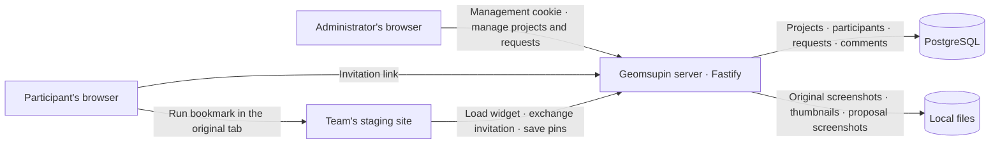

# Geomsupin architecture

[한국어](architecture.md) · English

Geomsupin runs on a single Node.js server with PostgreSQL and local file storage. The server serves the management app, invitations, widget JavaScript, API, and screenshots. The team hosts the site under review on a separate origin.

On a dual-entry host, HTTPS on port 3443 and HTTP on port 3080 run as separate installations with their own databases, storage and secrets. Each accepts review sites over its own protocol. The public installation endpoint can return the configured peer origin for a link to its home page. Management sessions and invitation permissions belong to the installation that issued them. [Dual-entry setup](../deploy/onprem/README.md#add-an-http-entry-on-port-3080)



## Links and permissions

The installation CLI issues a management link. Its secret follows `#manage=` in the URL fragment, so the browser leaves it out of the initial HTTP request. The management app removes it from the address bar and exchanges it once. The server checks the token hash and expiry, then issues a management session cookie. A management link expires after 15 minutes. A management session lasts up to 30 days. Issuing another link for the same workspace ends its existing management sessions. [Issue a management link](../server/installation-admin.ts) · [Exchange a session](../server/routes/auth.ts)

Participants open `/r/…` and save a project-specific bookmark in their browser. When they run the bookmark in the site's top-level tab, it checks the registered origin and loads `/w.js` from the Geomsupin server. The loader sends the invitation and connection ID to `POST /api/w/bookmark-session` and receives a review session. The server checks the site origin, project, and invitation expiry and revocation. Pins, comments, and status changes then use the widget API. [Create the bookmark](../shared/bookmarklet.ts) · [Start the bookmark](../widget/bookmark.ts) · [Widget API](../server/routes/widget.ts)

The optional in-app preview opens the registered site in an iframe. When the staging site has the connection script, the two windows verify the origin, connection ID, and handshake nonce before transferring the session. [In-app preview](../admin/src/pages/ReviewPreview.tsx) · [Connection script](../widget/loader.ts)

A nickname is a display name. Geomsupin associates a participant's activity with the combination of their project and a browser-generated ID stored on the Geomsupin origin. Participants with an active link to the project can see pins and comments, post replies, and change status. Only the author can edit the body of their request or delete it through the widget. [Participant identity](../admin/src/reviewer.ts) · [Widget permissions](../server/routes/widget.ts)

## How a pin is saved

1. The widget uses Shadow DOM for its toolbar and pins. When a participant clicks a target, the widget records the page URL, DOM selector, position relative to the element, and viewport dimensions, then starts capturing the visible screen. [Widget](../widget/core.ts) · [Position metadata](../widget/env.ts)
2. The widget loads the capture module when the participant starts writing a request. The module masks designated areas in a DOM clone and renders a screenshot. Position proposals reorder siblings in the clone to produce a second screenshot for comparison. [Capture](../widget/capture.ts) · [Position proposals](../widget/position-proposal.ts)
3. The server validates and re-encodes the images with Sharp. It stores the images as files and saves their keys with the request in PostgreSQL. A submission ID prevents duplicate requests when the same submission is retried. The server issues expiring signed URLs for screenshots. [Image processing](../server/images.ts) · [File storage](../server/storage.ts)
4. After a write succeeds, the server sends a change notification by Server-Sent Events (SSE) to open review sessions in the same project. The widget fetches the list or conversation again with its current permissions. It reconnects and polls to catch up after an interruption. The management app polls for changes while its tab is visible. The server keeps active SSE subscriptions in process memory. [Server events](../server/review-events.ts) · [Browser subscriptions](../widget/review-events.ts)

Masking applies to regions marked with `data-review-mask` and certain fields identified as sensitive, such as password inputs. When a pin target is inside or contains a masked area, the widget omits its text hint and uses a structural selector. The page title and parts of the URL, including its path, ordinary query parameters, and SPA routes, can still be stored as separate request metadata. Recognized credential parameters are stripped before transmission and storage. Upgrading also removes them from existing request URLs. Earlier backups and exported workbooks retain the values they originally contained. Each download through a widget screenshot URL checks the review session and invitation again. Revoking the invitation blocks further downloads through that session. Links issued by the dashboard or an Excel export expire independently. [Mask detection](../widget/privacy.ts) · [URL normalization](../shared/constants.ts) · [File access](../server/app.ts)

## Management and operational data

| Location | Responsibility |
| --- | --- |
| [admin/src](../admin/src) | React management app, invitations, project settings, and request search and editing |
| [server/routes/requests.ts](../server/routes/requests.ts) | Workspace-scoped request access and updates, and Excel export |
| [server/excel.ts](../server/excel.ts) | XLSX generation for request lists, screenshot sheets, and links to original screenshots |
| [server/migrations](../server/migrations) | Database schema changes applied in numerical order when the server starts |
| [server/backup.ts](../server/backup.ts) | Backup and restore of a database snapshot and its associated screenshots |
| [scripts](../scripts) | Commands for installation, management links, builds, deployment, and backups |
| [tests](../tests) | API and operations checks against PostgreSQL, and collaboration checks in multiple browsers |

The build writes to `dist/admin/` and `dist/widget/` by default. Staging loads the small entry point at `/w.js`. The widget and capture bundle filenames include content hashes. Screenshots go to `DATA_DIR/captures/` by default, and integrated backups go to `DATA_DIR/backups/`. [Project overview](../README.md) · [Installation and operations](../deploy/onprem/README.md)

## Tutorial video

The admin app selects a video and poster for the current language. Each MP4 shows the matching interface with captions burned into the picture for sharing. The player reads chapter names and timestamps from that recording’s WebVTT file. The server serves these files under `/tutorial/`, and the browser requests byte ranges during playback. [Player](../admin/src/Tutorial.tsx) · [Video and captions](../admin/public/tutorial) · [User guide](usage.en.md)

To record the tutorial again, prepare a test-only PostgreSQL database (`TEST_DATABASE_URL`), Chromium, FFmpeg, OpenSSL, xdotool, and a dedicated 1440×810 X11 display (`DISPLAY`). The recorded browser maps `review.example.com` and `studio.example.com` to local HTTPS servers. From the repository, build once and record the editions in separate runs. Keep the same display and test database available for both commands. Add `--dry-run` to either recording to rehearse it. [Recording script](../scripts/tutorial-record.ts)

```bash
export DIST_DIR=dist-tutorial
npm run build
npm run tutorial:record -- --language=ko
npm run tutorial:record -- --language=en
```
