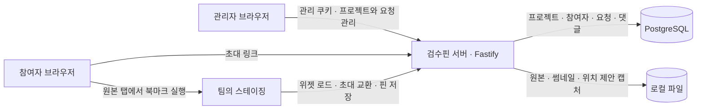

# 검수핀 구현 구조

한국어 · [English](architecture.en.md)

검수핀은 조직이 운영하는 단일 Node.js 서버, PostgreSQL, 로컬 파일 저장소로 구성됩니다. 서버 한 곳에서 관리 화면, 초대 화면, 위젯 JavaScript, API, 캡처 파일을 제공합니다. 검수할 웹사이트는 팀이 운영하는 별도 출처에서 원래대로 서비스합니다.

같은 호스트에 두 입구를 운영할 때에는 3443 HTTPS와 3080 HTTP가 각각 별도 DB·저장소·비밀값을 사용합니다. 각 설치는 같은 프로토콜의 검수 사이트를 받습니다. 공개 설치 API는 상대 입구가 설정된 경우 첫 화면 링크에 쓸 출처를 반환합니다. 관리 세션과 초대 권한은 발급한 설치에 속합니다. [두 입구 설치](../deploy/onprem/README.ko.md#3080-포트에-http-입구-추가)



## 링크와 권한

관리 링크는 서버에서 CLI로 발급합니다. 링크의 비밀값은 URL의 `#manage=` 뒤에 있어 최초 HTTP 요청에 담기지 않습니다. 관리 화면이 이를 한 번 교환하고 주소창에서 지웁니다. 서버는 토큰 해시와 만료 시각을 확인해 관리 세션 쿠키를 발급합니다. 관리 링크의 유효기간은 15분, 관리 세션은 30일입니다. 같은 작업공간에서 재발급하면 기존 관리 세션도 종료됩니다. [관리 링크 발급](../server/installation-admin.ts) · [세션 교환](../server/routes/auth.ts)

참여자는 `/r/…`에서 프로젝트별 북마크를 자기 브라우저에 저장합니다. 원래 사이트의 최상위 탭에서 북마크를 누르면 등록 출처를 확인하고 검수핀 서버의 `/w.js`를 읽습니다. 로더가 `POST /api/w/bookmark-session`에 초대와 연결 ID를 보내고 세션을 받습니다. 서버는 해당 사이트 출처와 프로젝트, 초대의 유효기간·폐기를 확인합니다. 이후 핀·댓글·상태 변경에는 기존 위젯 API를 사용합니다. [북마크 생성](../shared/bookmarklet.ts) · [북마크 시작](../widget/bookmark.ts) · [위젯 API](../server/routes/widget.ts)

선택형 브라우저 미리보기에서는 초대 화면이 등록된 사이트를 iframe으로 엽니다. 스테이징에 연결 스크립트가 설치되어 있으면 양쪽 창이 출처·연결 ID·요청값을 확인한 뒤 세션을 전달합니다. [미리보기](../admin/src/pages/ReviewPreview.tsx) · [연결 스크립트](../widget/loader.ts)

별명은 화면에 표시할 이름입니다. 검수핀 출처에 저장한 브라우저 식별자와 프로젝트의 조합으로 참여자의 기록을 연결합니다. 프로젝트의 활성 링크를 받은 참여자는 핀과 댓글을 보고 의견과 상태 변경을 남길 수 있습니다. 요청 본문 수정·삭제에는 작성자 확인이 추가됩니다.

## 핀을 저장할 때

1. 스테이징에서 로드된 위젯이 Shadow DOM에 도구 모음과 핀을 표시합니다. 사용자가 대상을 클릭하면 페이지 주소, DOM 선택자, 요소 안의 상대 위치, 화면 크기와 당시 보이는 화면을 수집합니다. [위젯](../widget/core.ts) · [위치 정보](../widget/env.ts)
2. 캡처 모듈은 작성할 때 로드합니다. DOM 복제본에 가림 처리를 적용하고 화면 이미지를 만듭니다. 위치 변경 제안은 복제본에서만 형제 요소의 순서를 바꾸어 비교 이미지를 추가합니다. [캡처](../widget/capture.ts) · [위치 변경](../widget/position-proposal.ts)
3. 서버는 이미지를 검증하고 Sharp로 다시 인코딩합니다. 파일 저장소에는 이미지 실체를, DB에는 파일 키와 요청을 저장합니다. 같은 제출을 재시도하면 요청 식별자로 중복을 방지합니다. 캡처를 읽을 때는 서버가 만료 시간이 있는 서명 URL을 발급합니다. [이미지 처리](../server/images.ts) · [파일 저장소](../server/storage.ts)
4. 쓰기가 완료되면 서버가 같은 프로젝트의 열린 검수 세션에 SSE로 변경을 알립니다. 위젯은 현재 권한으로 목록이나 대화를 다시 읽습니다. 연결이 끊기면 재연결과 주기적 조회로 따라잡습니다. 서버가 초대 종료나 세션 만료를 알리면 위젯은 그 탭에 표시한 핀을 지우고 대화창과 요청 작성창을 닫습니다. 관리 화면은 탭이 보일 때 목록을 주기적으로 갱신합니다. 실시간 알림의 구독 목록은 서버 프로세스 메모리에 있습니다. [서버 알림](../server/review-events.ts) · [브라우저 구독](../widget/review-events.ts)

가림 처리는 `data-review-mask`가 지정된 영역과 비밀번호 등으로 식별된 일부 입력 요소에 적용됩니다. 가림 영역 안의 요소나 가림 영역을 포함하는 요소에 놓은 핀은 요소의 텍스트 힌트를 저장하지 않고 구조 선택자를 사용합니다. 페이지 제목과 주소의 경로·일반 쿼리·SPA 라우트는 별도 요청 정보로 남을 수 있습니다. 알려진 인증·서명 파라미터는 보내거나 저장하기 전에 제거하며, 업데이트하면 기존 요청 주소에서도 제거합니다. 이전에 만든 백업과 엑셀 파일에는 당시 저장한 값이 남습니다. 위젯에서 받은 캡처 주소는 파일을 열 때 검수 세션과 초대 유효성을 다시 확인합니다. 초대를 폐기하면 해당 참여자 주소로 다시 내려받을 수 없습니다. 관리자 화면과 엑셀에서 발급한 파일 주소는 독립적으로 만료됩니다. [가림 판정](../widget/privacy.ts) · [주소 정규화](../shared/constants.ts) · [파일 접근](../server/app.ts)

## 관리 화면과 운영 데이터

| 위치 | 맡은 일 |
| --- | --- |
| [admin/src](../admin/src) | React 관리 화면, 초대, 프로젝트 설정, 요청 검색·수정 |
| [server/routes/requests.ts](../server/routes/requests.ts) | 작업공간별 요청 조회와 변경, 엑셀 내보내기 |
| [server/excel.ts](../server/excel.ts) | 요청 목록과 캡처 시트, 원본 링크를 포함한 XLSX 생성 |
| [server/migrations](../server/migrations) | DB 스키마 변경 이력. 서버가 시작할 때 번호순으로 적용 |
| [server/backup.ts](../server/backup.ts) | 같은 DB 스냅샷의 요청과 캡처를 묶어 백업하고 복구 |
| [scripts](../scripts) | 설치, 관리 링크, 빌드, 배포, 백업 명령 |
| [tests](../tests) | 실제 PostgreSQL을 쓰는 API·운영 검증과 여러 브라우저의 협업 검증 |

빌드 결과는 `dist/admin/`과 `dist/widget/`에 생깁니다. 스테이징에 붙이는 작은 진입점은 `/w.js`이고 위젯 본체와 캡처 모듈의 파일명에는 내용 해시가 들어갑니다. 캡처 기본 경로는 `DATA_DIR/captures/`, 통합 백업 기본 경로는 `DATA_DIR/backups/`입니다. [설치와 운영](../deploy/onprem/README.ko.md)

## 사용법 영상

관리 화면은 현재 언어에 맞는 영상과 포스터를 선택합니다. 각 MP4는 해당 언어 화면으로 녹화하고 자막을 영상에 입혀 공유할 수 있습니다. 플레이어는 해당 녹화의 WebVTT에서 챕터 이름과 시작 시간을 읽습니다. 서버는 `/tutorial/`에서 파일을 제공하며 브라우저는 재생할 때 필요한 구간을 요청합니다. [플레이어](../admin/src/Tutorial.tsx) · [영상과 자막](../admin/public/tutorial)

다시 녹화하려면 테스트 전용 PostgreSQL(`TEST_DATABASE_URL`), Chromium, FFmpeg, OpenSSL, xdotool과 전용 1440×810 X11 화면(`DISPLAY`)을 준비합니다. 녹화용 브라우저에서만 `review.example.com`과 `studio.example.com`을 로컬 HTTPS 서버에 연결합니다. 아래처럼 한 번 빌드한 뒤 같은 디스플레이와 테스트 DB로 한국어와 영어 영상을 차례로 녹화합니다. 각 녹화 명령 끝에 `--dry-run`을 추가하면 동작만 확인할 수 있습니다. [녹화 스크립트](../scripts/tutorial-record.ts)

```bash
export DIST_DIR=dist-tutorial
npm run build
npm run tutorial:record -- --language=ko
npm run tutorial:record -- --language=en
```
