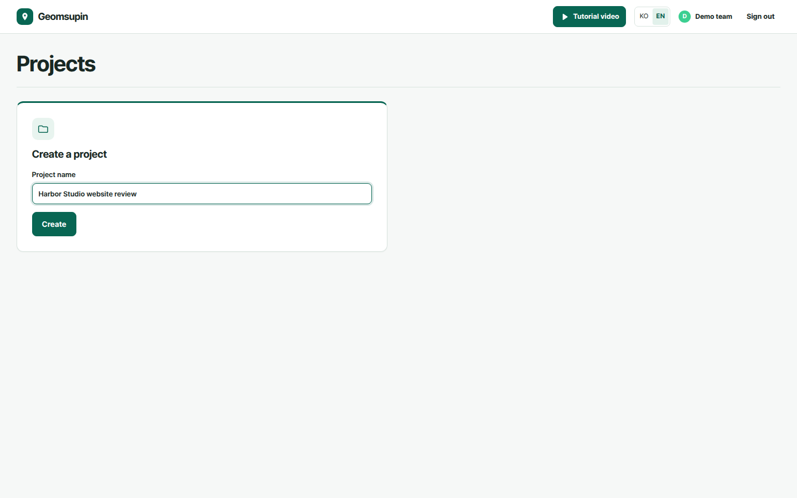
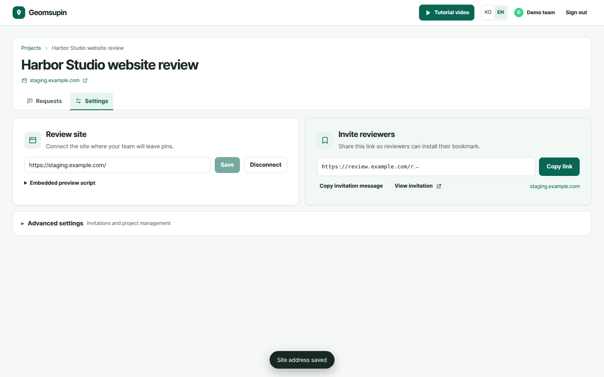
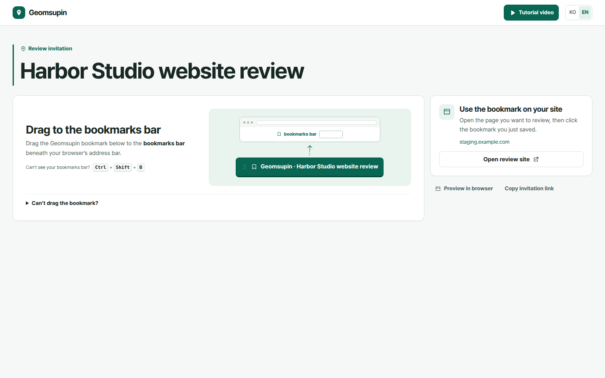
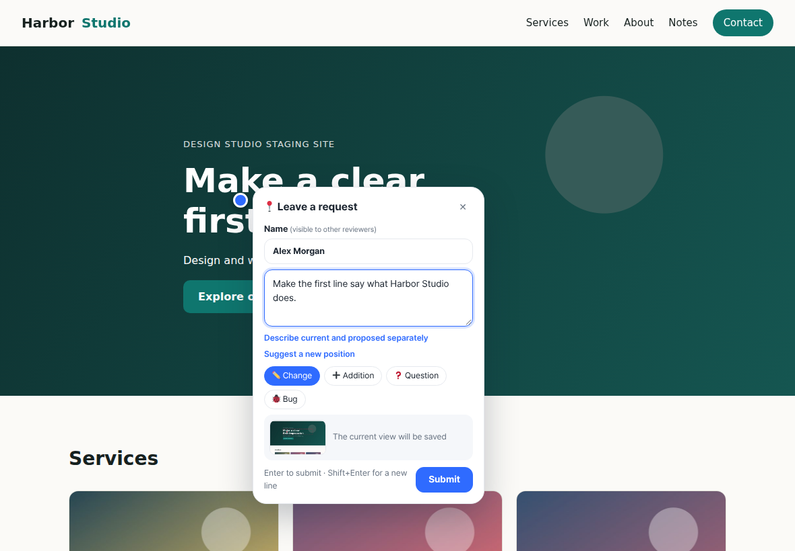
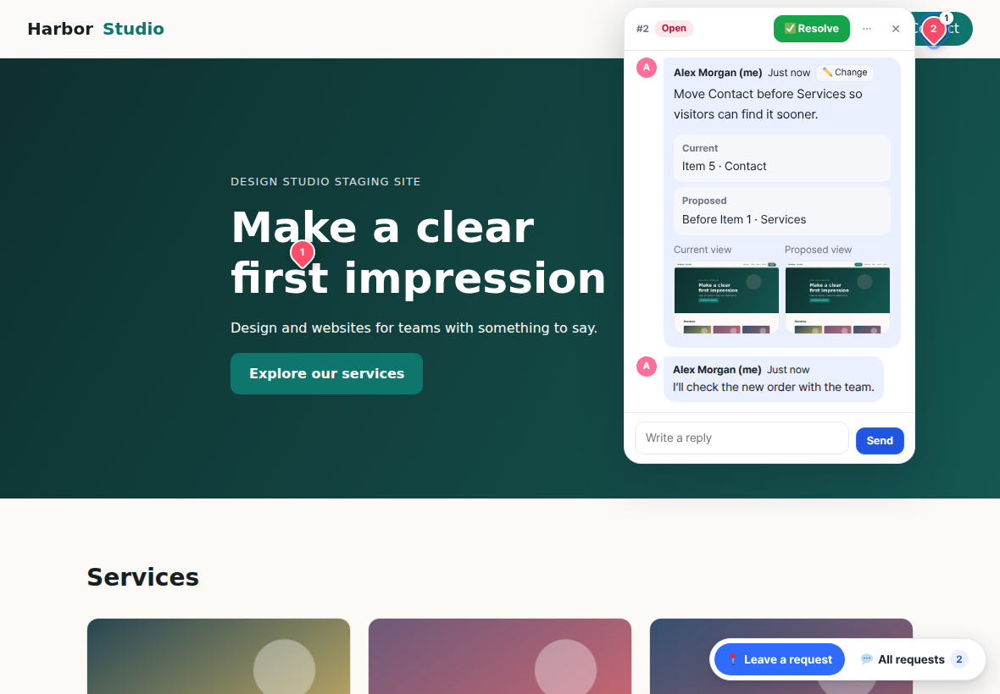
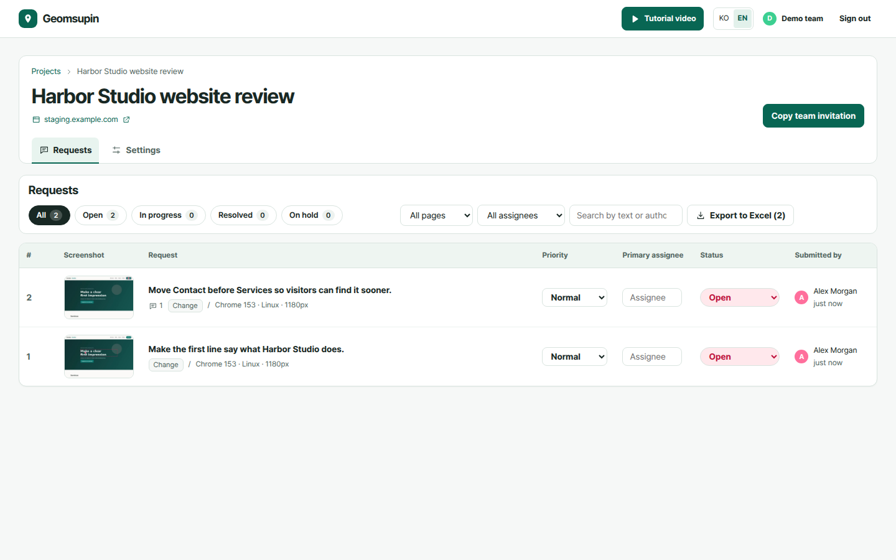

# Getting started with Geomsupin

[한국어](usage.md) · English

Select **Tutorial video** at the top of the app to watch a project go from setup to pins and replies. Select **EN** for English captions and chapters. The recording shows the Korean interface. [MP4 video](../admin/public/tutorial/review-guide.mp4?raw=true) · [English captions](../admin/public/tutorial/review-guide.en.vtt?raw=true) · [Korean captions](../admin/public/tutorial/review-guide.ko.vtt?raw=true)

## Invite your team

Open the administrator link and create a project. On a new installation, run `npm run manage` on the server to issue the administrator link. [Installation guide](../deploy/onprem/README.md)

In **Settings**, save the address under **Review site**. Select **Copy link** and send the invitation to your team. Use **View invitation** to see what recipients will see.

## Save the bookmark in your browser

On a computer, open the invitation directly or paste it into **Invitation link** on the Geomsupin home page and select **Open invitation**. Drag **Geomsupin · Project name** to the bookmarks bar under the address bar. Use the shortcut shown on the page if the bar is hidden. For keyboard setup, open **Can’t drag the bookmark?** and follow the steps under **Copy bookmark code**. If you receive the invitation on your phone, use **Copy invitation link** to send it to a computer.

Select **Open review site** or switch to an existing tab for that site. Sign in and navigate as usual. Click the saved bookmark on the page you want to review. After opening a new page or reloading, click it again when you need the pin tool.

## Leave a pin and reply

1. Select **Leave a request** in the lower-right corner, then click the heading, button, image, or other element you want to review.
2. Enter your name and feedback. You can select **Change**, **Addition**, **Question**, or **Bug**. Wait for the screenshot preview and check it before selecting **Submit**.
3. Click the numbered pin to open the discussion. Replies and **Resolve** updates appear for other reviewers in the same project. Use **All requests** to find other requests.

The capture shows what was visible on the page. Password fields and areas marked `data-review-mask` are covered. Cross-origin frames and unavailable images may appear as striped areas. If capture fails, you can still submit a regular request without an image.

**Before submitting, check what will be shared.** Reviewers with any active invitation to the same project can see its requests, captures, replies, and **Resolution note**. The request also saves the page title and address, including ordinary URL query parameters and SPA route fragments. The title, address, and resolution note are included in the Excel export. Masking applies only to covered areas of the screenshot. If the page contains sensitive information, cancel the request and use a page that is safe to share.

## Suggest a new position

For example, to move the last item in a navigation menu to the beginning, pin that item and select **Suggest a new position**. Use **Drag on the page** to move it, or choose an order under **Proposed position**. Select **Preview proposal**. Review both views and select **Submit** to save the comparison with the pin.

You can reorder visible elements that share a parent. The proposal changes the screenshot copy. Apply approved layout changes to the staging site’s source separately.

## Manage requests and share results

Open the project’s **Requests** tab to see pins together in one list. Open a row to view the screenshot and discussion, reply, and update the assignee, status, priority, or **Resolution note**. **Export to Excel** exports the filtered list with captures, up to 500 requests at a time. Use status or page filters if you need multiple exports.

In **Settings → Advanced settings → Manage invitation links**, create links with different expiration dates for clients or teams. These links share the same project records. Select **Revoke** next to a link to end access through it. **End review** closes the review for all participants and keeps its records. To remove a project and its records, select **Delete project** and enter its name.

## If the bookmark does not open the pin tool

- **Check the tab’s address.** Use the bookmark in the original site tab on the registered scheme, host, and port. If you are on a separate sign-in provider’s page, finish signing in and return to the review site.
- **Open the current invitation.** If the administrator changed the linked site or invitation, save the bookmark again from the current invitation. If no message appears, reload the review site and try the bookmark again.
- **Check the site and browser policies.** The bookmark needs no script permanently added to the review site. It still needs the browser to run a JavaScript bookmark and the site to allow Geomsupin’s scripts and API connections. Restrictive policies can block the tool without showing a message. For internal staging, ask the site administrator to check those policies and whether your browser trusts the Geomsupin server’s HTTPS certificate.

The invitation also offers **Preview in browser**. To use pins there, an administrator must add the **Embedded preview script** from the project settings to the site and allow the site to be framed by Geomsupin. If the site blocks framing, use the bookmark in the original tab when its script and connection policies permit it.
