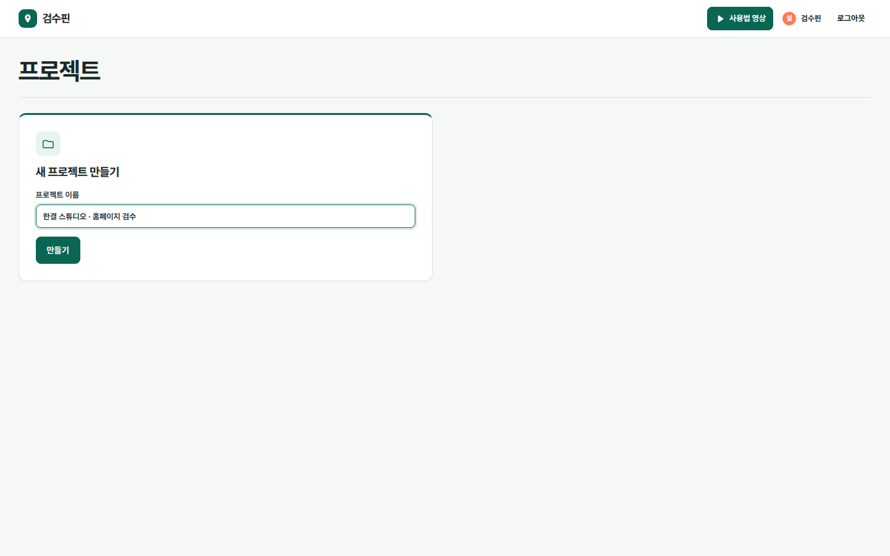
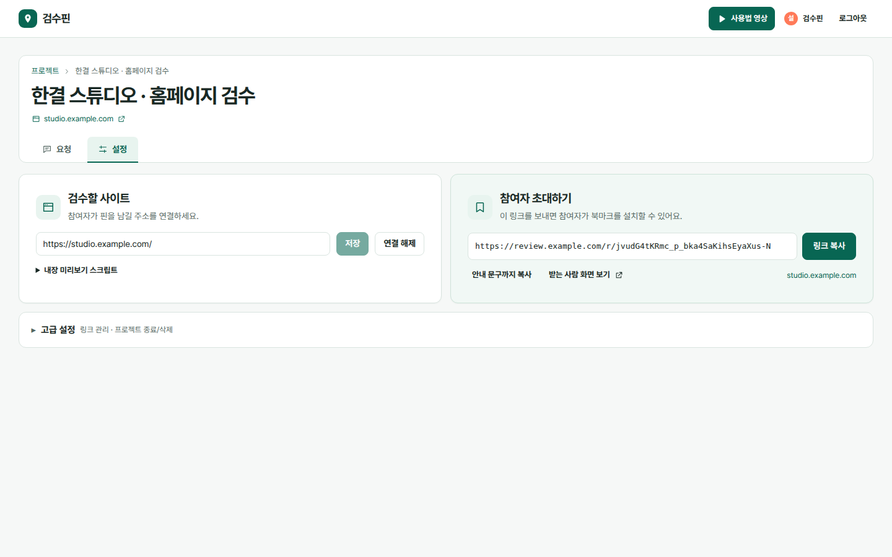
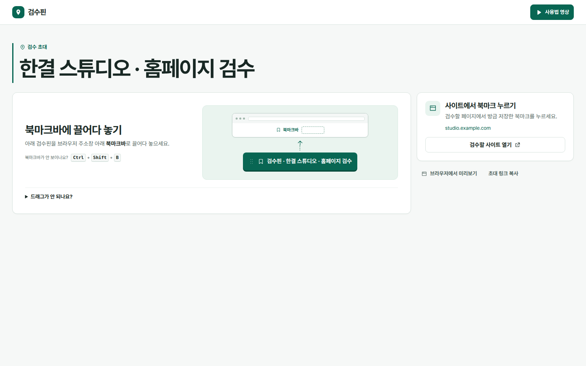

# 처음 사용하는 검수핀

앱 상단의 **사용법 영상**을 누르면 한국어 자막과 장면별 챕터로 프로젝트 생성부터 핀과 답글까지 볼 수 있습니다. 앱을 **EN**으로 전환하면 같은 영상에 영어 자막과 챕터가 표시됩니다. [MP4 영상](../admin/public/tutorial/review-guide.mp4?raw=true) · [한국어 자막](../admin/public/tutorial/review-guide.ko.vtt?raw=true) · [영어 자막](../admin/public/tutorial/review-guide.en.vtt?raw=true)

## 팀원 초대하기

관리 링크를 열고 프로젝트를 만듭니다. 첫 설치의 관리 링크는 서버에서 `npm run manage`로 발급합니다. [설치 가이드](../deploy/onprem/README.md)

프로젝트 **설정 → 검수할 사이트**에 주소를 저장하고 **링크 복사**를 눌러 동료에게 보냅니다. **받는 사람 화면 보기**에서 초대를 미리 확인할 수 있습니다.

## 내 브라우저에 북마크 저장하기

초대 링크를 바로 열거나 검수핀 첫 화면의 **초대 링크**에 붙여넣고 **초대 열기**를 누릅니다. **검수핀 · 프로젝트명**을 브라우저 주소창 아래 북마크바로 끌어 놓으세요. 북마크바가 숨겨져 있으면 화면에 표시된 단축키를 누릅니다. 키보드로 설정할 때는 **드래그가 안 되나요?**를 엽니다. 휴대폰으로 초대를 받았다면 **초대 링크 복사**로 PC에 전달하세요.

**검수할 사이트 열기**를 누르거나 이미 열어 둔 사이트 탭으로 이동합니다. 로그인과 화면 이동은 평소처럼 하세요. 검수할 장면에서 저장한 북마크를 누르면 핀 도구가 나타납니다. 페이지를 새로 연 뒤에는 북마크를 다시 누를 수 있습니다.

## 핀과 댓글 남기기

1. 오른쪽 아래 **요청 남기기**를 선택한 뒤 바꾸고 싶은 제목, 버튼, 이미지 등을 클릭합니다.
2. 별명과 원하는 변경 내용을 씁니다. 필요하면 **수정 · 추가 · 문의 · 버그** 중 하나를 고릅니다. 캡처 미리보기를 확인하고 **남기기**를 누릅니다.
3. 생성된 번호 핀을 누르면 대화가 열립니다. 동료가 댓글을 달거나 **해결**을 누르면 같은 프로젝트를 열어 둔 참여자 화면에 반영됩니다. **모두의 요청**에서 다른 요청도 찾을 수 있습니다.

캡처에는 당시 보이던 화면이 들어갑니다. 비밀번호 입력칸과 `data-review-mask`로 지정한 영역은 가려집니다. 다른 출처의 iframe이나 가져올 수 없는 이미지는 사선으로 표시될 수 있습니다. 캡처에 실패해도 일반 요청은 글로 남길 수 있습니다.

## 위치 변경 제안하기

예를 들어 상단 메뉴 끝의 **문의하기**를 맨 앞으로 옮기고 싶다면 해당 메뉴를 찍고 **위치 변경 제안**을 엽니다. **화면에서 끌기**로 옮겨 놓거나 **제안할 위치**에서 순서를 선택한 뒤 **제안 미리보기**를 누릅니다. 두 화면을 확인하고 **남기기**를 누르면 같은 핀에 비교 이미지가 저장됩니다.

같은 부모 안에서 화면에 보이는 형제 요소 간의 순서 변경을 지원합니다. 제안은 캡처 복제본에 적용됩니다. 팀이 승인한 배치는 스테이징 소스에 직접 반영합니다.

## 요청 처리하고 결과 공유하기

관리자가 프로젝트의 **요청** 탭을 열면 위치별 피드백을 한 목록에서 봅니다. 행을 열어 캡처와 대화를 확인하고 담당자, 상태, 우선순위, 처리 메모를 갱신합니다. **엑셀로 받기**는 현재 필터에 맞는 요청을 내려받습니다. 한 번에 500건까지 내보내므로 더 많으면 상태나 페이지 필터로 나눕니다.

**설정 → 고급 설정 → 링크 관리**에서 고객사나 팀별로 만료 기간이 다른 링크를 발급할 수 있습니다. 같은 프로젝트의 링크로 들어온 사람들은 같은 요청과 댓글을 봅니다. 특정 팀의 접근을 닫으려면 그 링크의 **폐기**를 누릅니다. **검수 종료하기**는 모든 참여자의 검수를 닫고 기록을 보관합니다. 프로젝트와 기록을 지우려면 **프로젝트 삭제**를 누르고 프로젝트 이름을 입력합니다.

## 북마크를 눌러도 도구가 보이지 않을 때

- **사이트 주소를 확인하세요.** 북마크는 프로젝트에 등록한 사이트에서 사용합니다. 로그인 제공자 페이지에 있다면 로그인을 마치고 원래 사이트로 돌아오세요.
- **초대 화면을 다시 여세요.** 관리자가 연결 주소나 초대를 바꿨다면 현재 초대에서 북마크를 다시 저장합니다.
- **사이트가 외부 스크립트를 제한할 수 있습니다.** 사내 스테이징에서는 운영자에게 검수핀 서버의 HTTPS 인증서 신뢰와 사이트의 스크립트·API 허용 정책을 확인해 달라고 하세요.

초대의 브라우저 미리보기도 쓸 수 있습니다. 미리보기 안에서 핀을 사용하려면 설정에서 제공하는 연결 스크립트를 스테이징에 설치합니다. 사이트가 외부 페이지 삽입을 막으면 원래 사이트 탭에서 북마크를 사용하세요.
