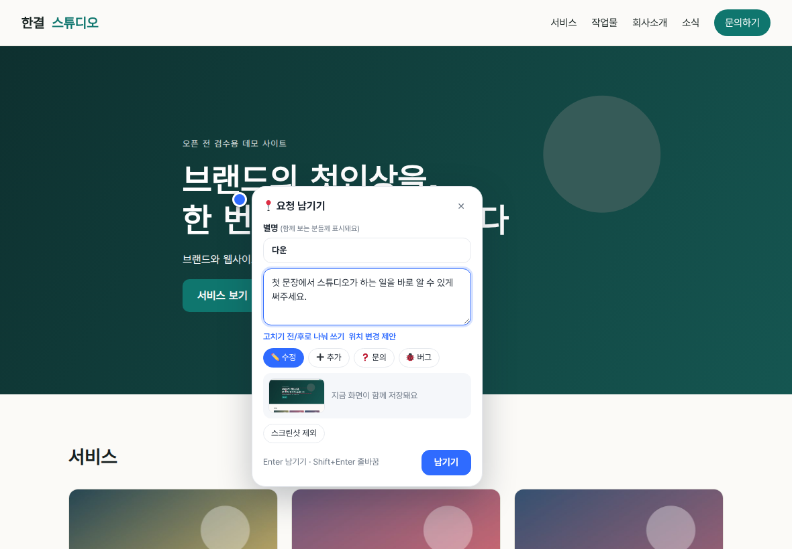
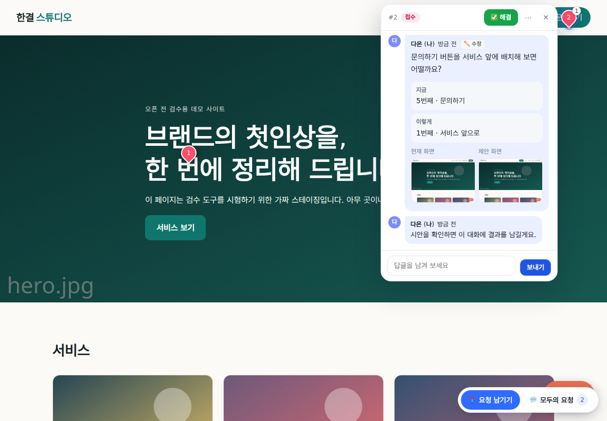
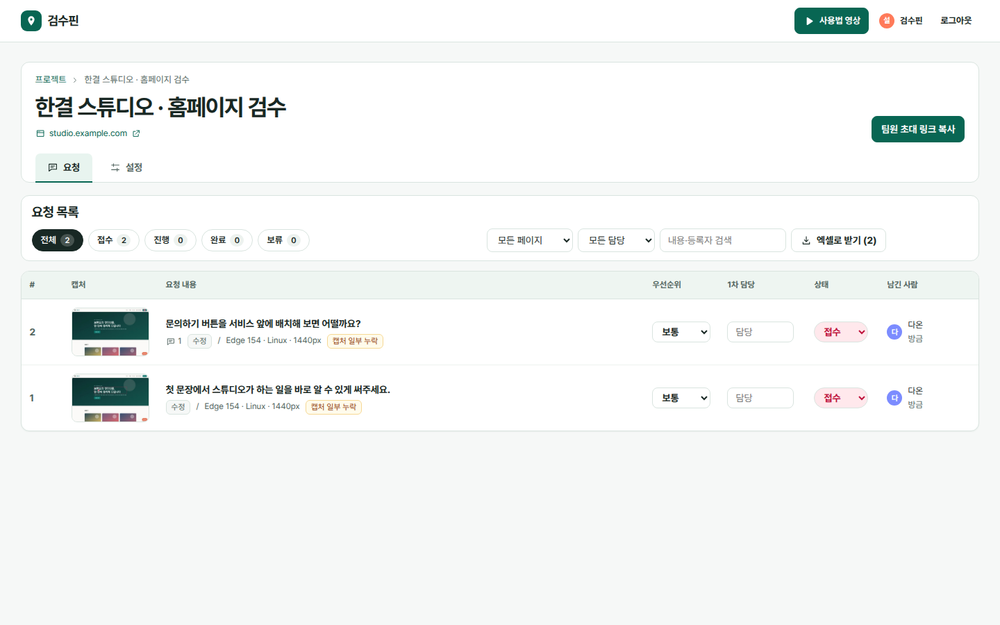

# 처음 사용하는 검수핀

한국어 · [English](usage.en.md)

앱 상단의 **사용법 영상**에서 프로젝트를 만들고 첫 핀에 답글을 달기까지의 과정을 볼 수 있습니다. 한국어 영상은 화면과 자막이 모두 한국어이며, **EN**을 선택하면 영어 화면으로 촬영한 영상을 볼 수 있습니다. 두 영상 모두 자막이 영상에 들어 있어 내려받아 공유할 수 있습니다. [한국어 MP4 다운로드](../admin/public/tutorial/review-guide.mp4?raw=true) · [영어 영상](usage.en.md)

## 팀원 초대하기

관리 링크를 열고 프로젝트를 만듭니다. 첫 설치의 관리 링크는 서버에서 `npm run manage`로 발급합니다. [설치 가이드](../deploy/onprem/README.ko.md)

프로젝트 **설정 → 검수할 사이트**에 주소를 저장하고 **링크 복사**를 눌러 동료에게 보냅니다. **받는 사람 화면 보기**에서 초대를 미리 확인할 수 있습니다.

## 내 브라우저에 북마크 저장하기

초대 링크를 바로 열거나 검수핀 첫 화면의 **초대 링크**에 붙여넣고 **초대 열기**를 누릅니다. **검수핀 · 프로젝트명**을 브라우저 주소창 아래 북마크바로 끌어 놓으세요. 북마크바가 숨겨져 있으면 화면에 표시된 단축키를 누릅니다. 키보드로 설정할 때는 **드래그가 안 되나요?**를 엽니다. 휴대폰으로 초대를 받았다면 **초대 링크 복사**로 PC에 전달하세요.

**검수할 사이트 열기**를 누르거나 이미 열어 둔 사이트 탭으로 이동합니다. 로그인과 화면 이동은 평소처럼 하세요. 검수할 장면에서 저장한 북마크를 누르면 핀 도구가 나타납니다. 페이지를 새로 연 뒤에는 북마크를 다시 누를 수 있습니다.

## 핀과 댓글 남기기

1. 오른쪽 아래 **요청 남기기**를 선택한 뒤 바꾸고 싶은 제목, 버튼, 이미지 등을 클릭합니다.
2. 별명과 원하는 변경 내용을 씁니다. 필요하면 **수정 · 추가 · 문의 · 버그** 중 하나를 고릅니다. 캡처를 첨부할 때는 미리보기가 표시될 때까지 기다려 확인한 뒤 **남기기**를 누릅니다. 글만 남기려면 미리보기 전후에 **스크린샷 제외**를 선택하세요.
3. 생성된 번호 핀을 누르면 대화가 열립니다. 동료가 댓글을 달거나 **해결**을 누르면 같은 프로젝트를 열어 둔 참여자 화면에 반영됩니다. **모두의 요청**에서 다른 요청도 찾을 수 있습니다.

캡처에는 당시 보이던 화면이 들어갑니다. 비밀번호 입력칸과 `data-review-mask`로 지정한 영역은 가려집니다. 다른 출처의 iframe이나 가져올 수 없는 이미지는 사선으로 표시될 수 있습니다. 서명이나 인증 파라미터가 붙은 이미지는 브라우저가 직접 읽을 수 있을 때만 캡처에 넣습니다. 캡처에 실패해도 일반 요청은 글로 남길 수 있습니다. 설치에서 이미지 프록시를 사용하면 캡처를 준비할 때 일부 이미지 주소를 검수핀 서버에 보낼 수 있습니다.

**보내기 전에 공유될 내용을 확인하세요.** 같은 프로젝트의 유효한 초대 링크로 참여한 사람은 요청, 캡처, 댓글과 **처리 메모**를 볼 수 있습니다. 요청에는 페이지 제목과 주소가 저장되며, 주소에는 일반 쿼리와 SPA 경로가 포함됩니다. 이름이 일반적으로 인증값에 쓰이는 쿼리(예: 토큰·인증 코드·서명)는 일반 주소와 SPA 경로 모두에서 제거됩니다. 페이지 제목, 주소, 처리 메모는 엑셀에도 포함됩니다. 가림은 캡처 이미지의 가림 영역에만 적용됩니다. 민감정보가 보이는 화면이라면 요청을 취소하고 공유해도 되는 페이지에서 다시 남기세요.

## 위치 변경 제안하기

예를 들어 상단 메뉴 끝의 **문의하기**를 맨 앞으로 옮기고 싶다면 해당 메뉴를 찍고 **위치 변경 제안**을 엽니다. **화면에서 끌기**로 옮겨 놓거나 **제안할 위치**에서 순서를 선택한 뒤 **제안 미리보기**를 누릅니다. 두 화면을 확인하고 **남기기**를 누르면 같은 핀에 비교 이미지가 저장됩니다.

같은 부모 안에서 화면에 보이는 형제 요소 간의 순서 변경을 지원합니다. 제안은 캡처 복제본에 적용됩니다. 팀이 승인한 배치는 스테이징 소스에 직접 반영합니다.

## 요청 처리하고 결과 공유하기

관리자가 프로젝트의 **요청** 탭을 열면 위치별 피드백을 한 목록에서 봅니다. 행을 열어 캡처와 대화를 확인하고 담당자, 상태, 우선순위, 처리 메모를 갱신합니다. **엑셀로 받기**는 현재 필터에 맞는 요청을 내려받습니다. 한 번에 500건까지 내보내므로 더 많으면 상태나 페이지 필터로 나눕니다.

**설정 → 고급 설정 → 링크 관리**에서 고객사나 팀별로 만료 기간이 다른 링크를 발급할 수 있습니다. 같은 프로젝트의 링크로 들어온 사람들은 같은 요청과 댓글을 봅니다. 특정 팀의 접근을 닫으려면 그 링크의 **폐기**를 누릅니다. 해당 링크로 참여자 위젯에서 발급된 캡처 주소의 새 다운로드도 중지됩니다. 이미 내려받은 파일과 관리자가 공유한 엑셀은 별도로 관리하세요. **검수 종료하기**는 모든 참여자의 검수를 닫고 기록을 보관합니다. 프로젝트와 기록을 지우려면 **프로젝트 삭제**를 누르고 프로젝트 이름을 입력합니다.

## 사이트별 사용 조건

| 사이트 상태 | 사용 방법 |
| --- | --- |
| 검수핀 스크립트와 API 연결을 허용하는 HTTPS 스테이징 | 원본 탭에서 평소처럼 로그인한 뒤 프로젝트 북마크를 누르세요. |
| 네이버 메인처럼 다른 사이트 안에 표시되는 것을 막는 곳 | 검수핀 안에서 미리보기를 열 수 없습니다. 원본 탭에서 북마크가 작동하는지는 해당 사이트의 스크립트·연결 정책에 달려 있습니다. |
| 사이트나 브라우저가 북마크 실행, 스크립트 로딩 또는 API 연결을 차단하는 곳 | 그 페이지에서는 핀을 남길 수 없습니다. 팀이 운영하는 사이트라면 관리자에게 검수핀 출처 허용을 요청하세요. 외부 사이트는 해당 운영자가 정책을 관리합니다. |
| HTTP 주소만 있는 사내 사이트 | HTTPS 검수핀에는 HTTPS 검수 주소가 필요합니다. 팀이 관리하는 스테이징 앞단에서 HTTPS를 받고 내부 HTTP 앱으로 전달한 뒤, 참여자가 실제로 여는 HTTPS 주소를 등록하세요. |

원본 탭과 내장 미리보기는 작동 조건이 다릅니다. **브라우저에서 미리보기** 안에서 핀까지 쓰려면 대상 사이트가 iframe 표시를 허용하고 프로젝트 설정의 **내장 미리보기 스크립트**를 설치해야 합니다. [브라우저의 iframe 정책](https://developer.mozilla.org/en-US/docs/Web/HTTP/Reference/Headers/X-Frame-Options) · [혼합 콘텐츠 정책](https://developer.mozilla.org/en-US/docs/Web/Security/Defenses/Mixed_content)

## 북마크를 눌러도 도구가 보이지 않을 때

- **사이트 주소를 확인하세요.** 프로젝트에 등록한 주소와 프로토콜, 호스트, 포트가 같은 원본 사이트 탭에서 북마크를 누릅니다. 주소가 자동으로 이동하면 이동이 끝난 주소를 등록하고 북마크를 다시 저장하세요. 예를 들어 `naver.com`과 `www.naver.com`은 서로 다른 출처입니다. 로그인 제공자 페이지에 있다면 로그인 후 검수 사이트로 돌아오세요.
- **현재 초대를 확인하세요.** 관리자가 연결 주소나 초대를 바꿨다면 현재 초대에서 북마크를 다시 저장합니다. 아무 안내도 나타나지 않으면 검수 사이트를 새로고침한 뒤 다시 눌러 보세요.
- **사이트와 브라우저의 보안 정책을 확인하세요.** 원본 사이트에 스크립트를 미리 설치할 필요는 없습니다. 브라우저가 자바스크립트 북마크를 실행할 수 있어야 하고, 사이트가 검수핀 스크립트와 API 연결을 허용해야 합니다. 보안 정책에 따라 별도 안내 없이 차단될 수 있습니다. 사내 스테이징에서는 사이트 관리자에게 해당 정책과 브라우저에서 검수핀 서버의 HTTPS 인증서를 신뢰하는지 확인해 달라고 하세요.
